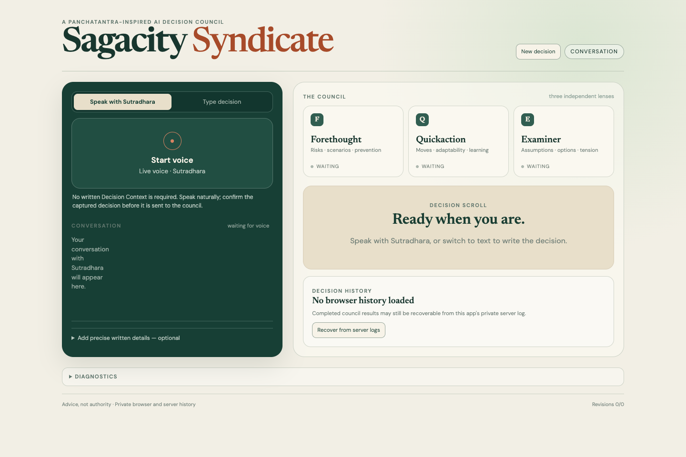
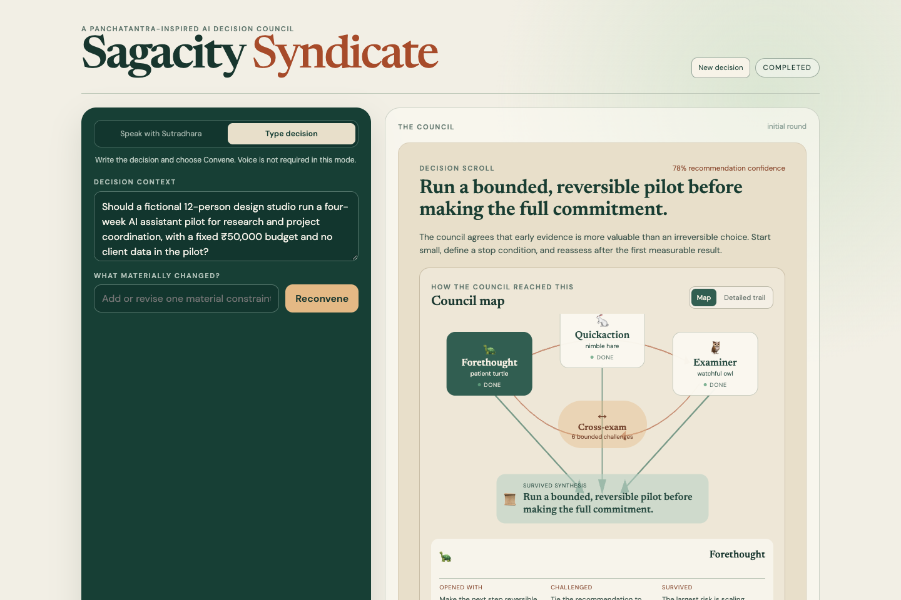

<div align="center">

# Sagacity Syndicate

**A Panchatantra-inspired AI Decision Council with a conversational moderator and three inspectable specialist perspectives.**

[](https://react.dev/)
[](https://www.typescriptlang.org/)
[](https://nodejs.org/)
[](https://developers.openai.com/api/docs/guides/live)
[](https://learn.microsoft.com/en-us/azure/ai-services/speech-service/voice-live-how-to)
[](ARCHITECTURE.md)
[](docs/VALIDATION_HISTORY.md)

[Quick start](#quick-start) · [Architecture](ARCHITECTURE.md) · [Azure deployment](docs/AZURE_DEPLOYMENT.md) · [User guide](USER_GUIDE.md) · [Validation](docs/VALIDATION_HISTORY.md)

</div>



Sagacity Syndicate is a local-first decision aid. A conversational moderator,
**Sutradhara**, helps frame the decision and presents the verified result. Three
bounded specialists deliberate behind the scenes:

- **Forethought** — future risks, scenarios, prevention, and second-order effects
- **Quickaction** — immediate moves, adaptability, and low-regret action
- **Examiner** — assumptions, contradictions, and missing options

The specialists first analyze independently, then cross-examine one another. A synthesis step produces the authoritative **Decision Scroll**. A separate Impact Router determines which perspectives must rerun when a material constraint changes.

The application supports two provider configurations from the same codebase:

| Provider | Voice moderator | Council runtime |
| --- | --- | --- |
| OpenAI | GPT-Live over browser WebRTC | OpenAI Agents API sessions |
| Azure Foundry | Voice Live through the server relay | Azure Responses-compatible model deployments |

Provider selection changes transport and model execution, not product authority. Sutradhara never becomes a fourth decision-maker, and only a schema-validated council synthesis may replace the visible Decision Scroll.

## What the proof of concept demonstrates

- voice and text intake feeding the same council state machine;
- explicit read-back and approval before a voice decision starts;
- three parallel specialist opinions and one bounded cross-examination round;
- revision-safe selective or full reconvening after a material change;
- a full on-screen Decision Scroll plus a short spoken executive briefing;
- conversational follow-up from the verified result without unnecessary reruns;
- local decision history, Markdown export, revision comparison, diagnostics, and Council Map;
- provider-neutral voice control with separate OpenAI and Foundry transports.

## Product tour

### From a decision to an inspectable council result

The text and voice paths converge on the same revision-safe council. The
completed view keeps the recommendation prominent while the Council Map shows
which specialist ideas were challenged and what survived synthesis.



The full Decision Scroll remains the authoritative artifact. Sutradhara receives
only a bounded Voice Brief for the spoken handoff, so the experience remains a
conversation rather than a report being read aloud.

## Quick start

Requires Node.js 22.6 or later.

```bash
npm ci
cp .env.example .env
npm run dev
```

Open [http://localhost:5173](http://localhost:5173). The default configuration uses `MOCK_COUNCIL=true`, so the text-first council works without provider credentials.

### OpenAI

```dotenv
MOCK_COUNCIL=false
COUNCIL_PROVIDER=openai
VOICE_PROVIDER=openai

OPENAI_API_KEY=your-project-key
OPENAI_LIVE_MODEL=gpt-live-1
OPENAI_COUNCIL_MODEL=your-agents-model
OPENAI_SYNTHESIS_MODEL=your-agents-model
```

The server exchanges the browser SDP offer with OpenAI. The API key never enters browser JavaScript.

### Azure Foundry

```dotenv
MOCK_COUNCIL=false
COUNCIL_PROVIDER=foundry
VOICE_PROVIDER=foundry

FOUNDRY_OPENAI_ENDPOINT=<azure-openai-v1-endpoint>
FOUNDRY_API_KEY=your-resource-key
FOUNDRY_COUNCIL_DEPLOYMENT=your-council-deployment
FOUNDRY_SYNTHESIS_DEPLOYMENT=your-synthesis-deployment

FOUNDRY_VOICE_ENDPOINT=<foundry-voice-https-endpoint>
FOUNDRY_VOICE_MODEL=gpt-realtime
```

Foundry configuration fails fast when the selected provider is missing its endpoint, deployment, or key. It does not silently fall back to OpenAI or mock execution.

Keep `.env` local. It is ignored by Git. Never put credentials in screenshots, logs, tracked documentation, or browser code.

## Deploy to Azure

The verified hosted topology runs the React UI and Express control plane in one
Linux Node.js 22 Azure App Service, protects it with Microsoft Entra Easy Auth
plus an owner-principal check, relays Foundry Voice Live control server-side,
and invokes Azure Responses-compatible council deployments without exposing the
resource key to browser JavaScript.

See [Deploy to Azure](docs/AZURE_DEPLOYMENT.md) for the complete step-by-step
setup, including:

- Foundry endpoint and deployment requirements;
- App Service runtime, startup, build, WebSocket, and environment settings;
- Easy Auth and `OWNER_PRINCIPAL_ID` configuration;
- clean ZIP creation and deployment;
- health, voice, origin, and authentication checks; and
- repeat deployment and rollback guidance.

The high-level system and trust-boundary diagrams are in
[Architecture](ARCHITECTURE.md#1-system-at-a-glance).

## Use

### Voice

1. Select **Speak with Sutradhara** and start voice.
2. Hold the control while speaking, then release.
3. Sutradhara reads back the captured decision.
4. Confirm the exact decision before the council starts.
5. Watch the three truthful specialist states while the council deliberates.
6. Read the full Decision Scroll and hear the short verbal briefing.
7. Ask “Why?” or ask about one specialist without rerunning the council.
8. State a changed fact. The application reflects the change and waits for confirmation before reconvening.

OpenAI native delegation metadata is retained when available, but it never bypasses explicit confirmation. Foundry uses the same application-owned approval contract without pretending to expose OpenAI-native delegation.

### Text

1. Select **Type decision**.
2. Enter the decision, objective, constraints, and time horizon.
3. Select **Convene the council**.
4. Add a changed fact and select **Reconvene** when needed.

Both paths produce the same validated Decision Scroll schema.

## Core authority model

```text
conversation or typed intake
        ↓
application readiness + explicit approval
        ↓
three independent specialist opinions
        ↓
bounded cross-examination
        ↓
schema-validated synthesis
        ↓
Decision Scroll (authority) + Voice Brief (delivery)
```

- `conversationRevision` advances with accepted conversational context.
- `deliberationRevision` advances only when a council round starts.
- Late results must match both captured revisions before they may render or speak.
- Non-material interjections do not cancel active work.
- A material correction remains pending until the user confirms or restates it.
- The previous verified Scroll remains authoritative while reconvening.

## Commands

```bash
npm run dev                    # Vite UI and Express server
npm run typecheck              # TypeScript project checks
npm test                       # hygiene check plus automated suite
npm run check:public-candidate # strict public-candidate artifact scan
npm run build                  # production client build
npm start                      # serve the production build
```

## Documentation

- [Architecture](ARCHITECTURE.md) — shared authority model, provider transports, council orchestration, persistence, and diagrams.
- [Azure deployment](docs/AZURE_DEPLOYMENT.md) — owner-authenticated App Service setup, Foundry settings, deployment, validation, and rollback.
- [Provider differences](docs/PROVIDER_DIFFERENCES.md) — explicit OpenAI/Foundry protocol and capability mapping.
- [Feature matrix](FEATURE_MATRIX.md) — implemented and deferred platform capabilities.
- [User guide](USER_GUIDE.md) — voice, text, reconvening, history, and troubleshooting.
- [Test plan](TEST_PLAN.md) — automated, mock, provider, microphone, and hosted-origin validation.
- [Device run guide](docs/DEVICE_RUN_GUIDE.md) — abbreviated owner-device acceptance procedure.
- [Validation history](docs/VALIDATION_HISTORY.md) — sanitized release evidence and clearly bounded claims.
- [ADR: explicit voice confirmation](docs/adr/0001-explicit-voice-confirmation.md) — why both providers share the same confirmation gate.
- [Behind the scenes](docs/BEHIND_THE_SCENES.md) and [interactive system map](docs/sagacity-system-map.html) — concise engineering case study and visual walkthrough.

## Privacy and limits

- API keys remain server-side.
- Audio and raw transcript deltas are not persisted.
- Local JSONL logs may contain bounded decision facts and final Scrolls; they are ignored by Git and should be redacted before sharing.
- The council does not currently research live prices, laws, schedules, or product claims. Recommendation confidence is therefore not factual certainty.
- This is a single-owner proof of concept. The hosted pilot has authentication,
  but it is not a multi-user production authorization system.
- High-stakes legal, medical, financial, employment, and safety decisions require independent verification.
