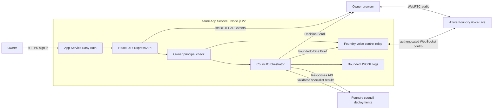

# Deploy Sagacity Syndicate to Azure

Last verified: 20 October 2026, against public `main` at `76cf77b`.

This guide deploys the existing application to Azure App Service with:

- Microsoft Entra sign-in through App Service Authentication (Easy Auth);
- an owner-only application check;
- Azure Foundry Voice Live for Sutradhara;
- Azure OpenAI/Foundry Responses deployments for the council;
- server-side provider credentials; and
- an allowlisted HTTPS browser origin.

It documents the owner-authenticated pilot topology that has been exercised in
a real browser. It is not a claim of multi-tenant production readiness.

## 1. Understand the deployed topology



The browser never receives `FOUNDRY_API_KEY`. The server uses it for the Voice
Live control connection and Responses calls. The browser receives only the
application UI, bounded events, and the media/control information needed for
the active voice session.

## 2. Prerequisites

You need:

1. An Azure subscription and permission to create or configure resources.
2. A Microsoft Foundry or compatible Azure OpenAI resource.
3. One or two Responses-compatible model deployments:
   - council deployment for specialists, readiness, materiality, and routing;
   - synthesis deployment for the final Decision Scroll.
4. Voice Live access and a supported voice model in the chosen resource/region.
5. A Linux Azure App Service using Node.js 22.
6. A Microsoft Entra identity that will own the pilot.
7. Git, Node.js 22.6 or later, npm, and optionally Azure CLI.

The present application has one `FOUNDRY_API_KEY` setting for both council and
voice. Use council and Voice Live endpoints that accept the same resource key.
Separate council and voice resources would require a code change to introduce a
separate voice credential.

Model and region availability changes over time. Confirm current availability
in the Azure portal before choosing deployments.

## 3. Prepare and verify the repository

From a clean checkout of the authoritative repository:

```bash
npm ci
npm run typecheck
npm test
npm run build
npm run check:public-candidate
npm audit
```

Do not deploy when one of these checks fails. Do not place a `.env` file, API
key, local log, screenshot containing a key, or private test trail in the ZIP.

## 4. Record the Foundry values

In the Azure portal, record these values without committing them:

| Application setting | Required value |
| --- | --- |
| `FOUNDRY_OPENAI_ENDPOINT` | Azure OpenAI v1 base URL, including `/openai/v1/`, such as `https://<resource>.openai.azure.com/openai/v1/` |
| `FOUNDRY_API_KEY` | Resource key accepted by both configured Foundry paths |
| `FOUNDRY_COUNCIL_DEPLOYMENT` | Deployment name used for specialist, router, readiness, and materiality calls |
| `FOUNDRY_SYNTHESIS_DEPLOYMENT` | Deployment name used for synthesis; it may equal the council deployment |
| `FOUNDRY_VOICE_ENDPOINT` | Base HTTPS resource endpoint, such as `https://<resource>.services.ai.azure.com`; do not append the Voice Live WebSocket path |
| `FOUNDRY_VOICE_MODEL` | Supported Voice Live model name, currently `gpt-realtime` in the verified pilot |

The server converts the Voice Live HTTPS base to the required secure WebSocket
control URL and appends its configured API version and model.

## 5. Create the App Service

In the Azure portal:

1. Select **Create a resource → Web App**.
2. Choose **Code** as the publish model.
3. Choose **Linux** as the operating system.
4. Choose **Node 22 LTS** as the runtime stack.
5. Select the subscription, resource group, region, App Service plan, and a
   globally unique app name.
6. Create the app and wait for deployment to finish.

Then open **Settings → Configuration** or **Settings → Environment variables**
and add:

```dotenv
SCM_DO_BUILD_DURING_DEPLOYMENT=true
HOST=0.0.0.0
MOCK_COUNCIL=false
COUNCIL_PROVIDER=foundry
VOICE_PROVIDER=foundry

FOUNDRY_OPENAI_ENDPOINT=https://<resource>.openai.azure.com/openai/v1/
FOUNDRY_API_KEY=<resource-key>
FOUNDRY_COUNCIL_DEPLOYMENT=<council-deployment-name>
FOUNDRY_SYNTHESIS_DEPLOYMENT=<synthesis-deployment-name>

FOUNDRY_VOICE_ENDPOINT=https://<resource>.services.ai.azure.com
FOUNDRY_VOICE_MODEL=gpt-realtime

ALLOWED_ORIGINS=https://<app-name>.azurewebsites.net
REQUIRE_OWNER_AUTH=true
OWNER_PRINCIPAL_ID=<owner-microsoft-entra-object-id>
LOG_DIRECTORY=/home/LogFiles/sagacity
```

Important details:

- Keep `ALLOWED_ORIGINS` as a comma-separated list of bare origins. Do not add a
  path, query, wildcard, trailing application route, username, or password.
- Do not set `PORT`; App Service supplies it and the server reads it.
- `HOST=0.0.0.0` is required so the App Service front end can reach Express.
- Mark secrets as deployment-slot settings if you use staging slots.
- `LOG_DIRECTORY` is optional. If set, protect and rotate the files because
  they may contain bounded decision facts and complete Decision Scrolls.

Under **Settings → Configuration → General settings**:

1. Set the startup command to `npm start` if App Service does not infer it.
2. Enable **HTTPS Only**.
3. Ensure WebSockets are enabled when the platform exposes that setting.
4. Enable **Always On** when the selected plan supports it to reduce cold-start
   delay for voice sessions.
5. Save and restart the app after configuration changes.

Build automation is important: this repository starts the TypeScript server
with `tsx` and builds the Vite client during deployment. Azure's Oryx build must
install the declared dependencies and run `npm run build`.

## 6. Enable owner-only Microsoft Entra authentication

In the App Service:

1. Open **Settings → Authentication**.
2. Select **Add identity provider**.
3. Choose **Microsoft**.
4. Use the current workforce tenant unless the pilot intentionally uses an
   external tenant.
5. Require authentication for all requests.
6. Configure unauthenticated browser requests to sign in, or return HTTP 401
   when an API-only response is preferred.
7. Restrict the tenant and identity according to the pilot's access policy.
8. Save the provider configuration.
9. Copy the intended owner's Microsoft Entra **Object ID** into
   `OWNER_PRINCIPAL_ID` and keep `REQUIRE_OWNER_AUTH=true`.

Easy Auth validates the sign-in before traffic reaches Express. The application
then compares the trusted `X-MS-CLIENT-PRINCIPAL-ID` header supplied by App
Service with `OWNER_PRINCIPAL_ID`. Both controls must succeed.

Do not expose the app anonymously and do not trust a client-supplied identity
header outside the App Service authentication boundary.

## 7. Create a clean deployment archive

From the repository root:

```bash
git status --short
git archive --format=zip --output=sagacity-syndicate.zip HEAD
shasum -a 256 sagacity-syndicate.zip
```

`git archive` includes tracked files from the selected commit and excludes the
ignored local `.env`, logs, dependencies, and build output. Record the commit
and archive checksum in a private deployment note.

## 8. Deploy the archive

The repeatable Azure CLI path is:

```bash
az login
az webapp deploy \
  --resource-group <resource-group> \
  --name <app-name> \
  --src-path sagacity-syndicate.zip \
  --type zip
```

You may also use the App Service deployment/Kudu interface. Whichever path you
choose, verify that server-side build automation is enabled and that deployment
history ends in **Success**. A ZIP downloaded directly from GitHub often has an
extra top-level directory; use `git archive` or otherwise ensure `package.json`
is at the ZIP root.

## 9. Verify health before voice

Open the HTTPS app URL in a current Chrome or Edge browser and complete the
Microsoft sign-in. Then visit:

```text
https://<app-name>.azurewebsites.net/api/health
```

Expected shape:

```json
{
  "ok": true,
  "mode": "live",
  "liveEnabled": true,
  "voiceProvider": "foundry"
}
```

If the page cannot start, inspect **Monitoring → Log stream** and the deployment
logs before changing provider credentials.

## 10. Run the minimum hosted voice acceptance test

1. Open the authenticated application root.
2. Select **Start voice** and allow microphone access for the HTTPS origin.
3. Hold to speak one short decision.
4. Release and verify Sutradhara reads back one coherent decision.
5. Say **Yes**.
6. Verify the UI changes to deliberating exactly once.
7. Wait for all three specialist cards to reach `done`.
8. Verify a complete Decision Scroll appears.
9. Verify Sutradhara gives a short briefing rather than reading the Scroll.
10. Open **Diagnostics** and check for `council.completed`, thinking/commentary
    acknowledgements, and audio/playback start events.

For this gate, a full reconvening regression is unnecessary when the same
commit already passed the automated and owner-device suites.

## 11. Check the access boundary

Verify all of the following:

- an anonymous or signed-out request cannot read `/api/health`;
- a forged `X-MS-CLIENT-PRINCIPAL-ID` cannot bypass Easy Auth;
- the approved hosted origin can open the Foundry voice relay;
- an origin absent from `ALLOWED_ORIGINS` cannot upgrade the relay;
- keys appear only in App Service settings and never in the built client,
  repository, screenshots, or shared logs.

Easy Auth may reject a request before the application-origin rule runs. That is
still a valid outer-boundary rejection; application-level origin behavior is
also covered by the automated origin-policy tests.

## 12. Redeploy and roll back safely

For each release:

1. update local `main`;
2. run the complete preflight in section 3;
3. create a new `git archive` from the exact commit;
4. record its checksum privately;
5. deploy it;
6. confirm deployment success and `/api/health`;
7. run the minimum hosted voice test.

Retain the previous known-good deployment record or deployment slot until the
new smoke test passes. Roll back through App Service deployment history or swap
back to the known-good slot when the new version cannot complete the health and
voice gates.

## 13. Troubleshooting

### App starts locally but not in Azure

- Confirm `HOST=0.0.0.0`.
- Confirm Node.js 22 and the startup command `npm start`.
- Confirm `SCM_DO_BUILD_DURING_DEPLOYMENT=true` and that Oryx ran the build.
- Confirm `package.json` is at the ZIP root.
- Read deployment and application log streams before redeploying.

### Health says mock or voice is disabled

- Confirm `MOCK_COUNCIL=false`.
- Confirm both provider selectors equal `foundry`.
- Confirm the endpoint, deployment, and key settings are present.
- Restart the App Service after changing settings.

### Voice stays on Connecting

- Confirm the browser granted microphone access to the HTTPS app origin.
- Confirm the hosted origin exactly matches one `ALLOWED_ORIGINS` entry.
- Confirm App Service WebSocket support and inspect the application log stream.
- Confirm the configured Voice Live model is available to the resource.
- Confirm `FOUNDRY_VOICE_ENDPOINT` is the HTTPS base endpoint, not a full
  WebSocket URL.

### Council fails while voice still works

- Check `FOUNDRY_OPENAI_ENDPOINT` includes `/openai/v1/`.
- Check that deployment names—not catalog model names—are configured.
- Confirm the selected deployments support Responses and strict structured
  output used by this application.
- Inspect the bounded error and `deliberations.jsonl` without sharing secrets.

## 14. Official references

- [Configure Node.js apps in Azure App Service](https://learn.microsoft.com/en-us/azure/app-service/configure-language-nodejs)
- [Deploy ZIP packages to Azure App Service](https://learn.microsoft.com/en-us/azure/app-service/deploy-zip)
- [Configure Microsoft Entra authentication for App Service](https://learn.microsoft.com/en-us/azure/app-service/configure-authentication-provider-aad)
- [App Service authentication and authorization](https://learn.microsoft.com/en-us/azure/app-service/app-service-authentication-overview)
- [Azure OpenAI Responses API](https://learn.microsoft.com/en-us/azure/ai-services/openai/quickstart)
- [Azure Voice Live API](https://learn.microsoft.com/en-us/azure/ai-services/speech-service/voice-live-how-to)
