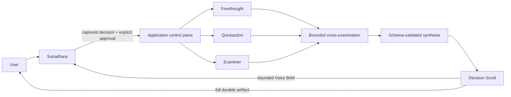

# Sagacity Syndicate: Behind the Scenes

Last updated: 20 October 2026

Sagacity Syndicate began with a simple product idea: let a person talk through
a decision with a wise moderator while three specialist perspectives deliberate
behind the scenes. Making that interaction dependable required more than adding
multiple model calls. The application had to define who holds authority, when a
spoken turn is complete, what may cancel work, and which result is safe to show
or speak.

This public case study summarizes the important engineering decisions. Detailed
working transcripts, decision examples, migration notes, and provider-session
evidence are intentionally retained outside the public repository.

For the normative design, see [Architecture](../ARCHITECTURE.md). For provider
protocol differences, see [Provider differences](PROVIDER_DIFFERENCES.md).

## 1. The product boundary

The system has four visible roles:

- **Sutradhara** holds the conversation, asks necessary clarifying questions,
  reports verified status, and explains the result.
- **Forethought** examines future risks, prevention, scenarios, and second-order
  effects.
- **Quickaction** proposes immediate, adaptable, low-regret moves.
- **Examiner** challenges assumptions, contradictions, and missing options.

Sutradhara is deliberately not a fourth decision-maker. Only the
application-owned council can produce or revise the authoritative Decision
Scroll.



## 2. Why the first voice flow could stall

The earliest implementation treated streaming transcript deltas as if each
delta were a new user turn. A delayed fragment from the same utterance that
caused delegation could therefore arrive after council work started and be
mistaken for an interruption. The application cancelled its own active round,
even though Sutradhara had already said the council was working.

The repair introduced explicit `VoiceTurn` aggregation and completion. Deltas
update an in-progress turn; only a completed later turn can be considered for
interruption. The turn that caused delegation is bound to that delegation and
cannot cancel its own work.

The resulting rule is fundamental:

```text
transcript fragment != completed user turn
completed user turn != authorized council start
spoken acknowledgement != backend completion
```

## 3. Conversation does not automatically invalidate deliberation

Users naturally say things such as “okay,” “go on,” or “what are they doing?”
while the council works. Cancelling expensive work for every utterance made the
system fragile and unnatural.

Sagacity therefore assesses completed interruptions with a bounded materiality
contract. Non-material conversation leaves the active round untouched. A
material new fact is reflected back to the user and must be confirmed before
the application advances revisions, requests cancellation, and reconvenes the
council. Ambiguous input preserves the current authoritative result until the
change is clear.

Two revision counters keep these responsibilities separate:

- `conversationRevision` tracks accepted changes to the conversation context;
- `deliberationRevision` identifies the council round allowed to become
  authoritative.

Every late result must still match the current revisions before it may render,
enter voice context, or be spoken.

## 4. The Decision Scroll and speech are different products

The full Decision Scroll is the durable decision artifact. It contains the
recommendation, rationale, specialist summaries, reconvening trigger, and
confidence. Reading all of that aloud produced an unnatural report rather than
a conversation.

The application now derives a bounded Voice Brief from the verified Scroll. It
contains only the recommendation, main reason, key tension, immediate action,
and optional reconvening trigger. Sutradhara paraphrases those facts into a
short executive briefing.

In the OpenAI configuration, verified background context uses the quiet Live
thinking channel while speakable briefing facts use commentary. In the Foundry
configuration, the adapter translates the same application contract to Voice
Live. Neither voice provider creates a competing decision.

## 5. The council remains explicit and inspectable

The council follows an application-owned state machine:

```text
ready
  -> delegating
  -> independent
  -> cross_examining
  -> synthesizing
  -> briefing
  -> completed
```

Material changes enter `reconvening` and preserve the previous Scroll until a
new synthesis is valid. Each specialist returns bounded structured fields. A
single bounded repair attempt handles malformed provider output; repeated
invalid output fails visibly rather than entering an unbounded retry loop.

The Council Map is a deterministic projection of validated opinions, peer
critiques, and synthesis. It does not expose private chain-of-thought or raw
provider payloads.

## 6. One application, two provider configurations

The consolidated repository supports:

| Edge | OpenAI configuration | Azure Foundry configuration |
| --- | --- | --- |
| Voice moderator | GPT-Live over browser WebRTC | Voice Live through browser WebRTC and a server control relay |
| Council runtime | OpenAI Agents API sessions | Azure Responses-compatible deployments |
| Initial start | Application confirmation; native delegation retained when available | Application confirmation without synthetic delegation |
| Result delivery | Quiet context plus commentary | Equivalent bounded context and response directive |

`LiveVoiceSession` owns shared turn and playback behavior behind a
`VoiceTransport` interface. `CouncilOrchestrator` depends on an `AgentRuntime`
interface. The state machine, schemas, revisions, Impact Router, Decision
Scroll, and UI remain provider-neutral.

## 7. Reliability lessons from supervised testing

| Observed problem | Engineering response |
| --- | --- |
| A trailing transcript fragment cancelled its own round | Aggregate fragments and bind the causal completed turn |
| Spoken acknowledgement did not always start work | Make explicit approval and application readiness authoritative |
| “Okay” cancelled deliberation | Assess materiality before cancellation |
| Full synthesis sounded like a report | Separate Decision Scroll from Voice Brief |
| A spoken correction changed meaning | Reflect the old and new constraint and require confirmation |
| Previous output disappeared during reconvening | Preserve the prior authoritative Scroll until replacement synthesis |
| Provider output exceeded schemas | State hard prompt limits and retain local validation |
| Pointer drift ended push-to-talk | Capture the pointer and use explicit release/cancel reasons |
| Refresh lost conversational grounding | Persist bounded Scroll and revision state, then rehydrate voice context |
| A late provider response arrived after a newer round | Gate every render and voice write by the captured revisions |

These were lifecycle failures, not merely prompt-quality problems. The fixes
therefore live in application state, schemas, transport boundaries, and tests.

## 8. Validation posture

The current consolidated release has automated coverage for orchestration,
schemas, provider adapters, voice turns, playback, confirmation, reconvening,
recovery, history, and the Council Map. Local owner-device runs exercised both
provider configurations. The merged public release also completed an
owner-authenticated Azure Foundry hosted flow covering spoken intake, explicit
approval, all council stages, Decision Scroll rendering, bounded voice context,
and audible briefing.

The repository keeps only a sanitized [Validation history](VALIDATION_HISTORY.md).
The [Test plan](../TEST_PLAN.md) and [Device run guide](DEVICE_RUN_GUIDE.md)
define the repeatable gates for later provider, model, transport, or hosting
changes.

## 9. Privacy and trust boundaries

The browser never receives a permanent provider credential. The application
does not persist microphone audio, raw transcript deltas, or chain-of-thought.
Local browser history stores bounded decision artifacts; server JSONL logs can
contain decision facts and complete Scrolls and therefore require review before
sharing.

The Azure pilot adds Microsoft Entra authentication at the platform edge and a
second owner-principal check in the application. It remains a single-owner
proof of concept rather than a multi-tenant production authorization system.

## 10. What remains intentionally out of scope

Sagacity does not yet provide:

- externally verified facts or citations;
- file, image, offer-letter, or spreadsheet evidence intake;
- multi-user authorization or database-backed history;
- production retention, deletion, backup, alerting, or formal SLOs; or
- side-effecting council tools.

The next substantive product phase should be evidence-aware decisions: a
read-only research step producing bounded, cited evidence shared with all three
specialists. That would improve factual grounding without weakening the
application-owned authority model.

## 11. The durable lesson

The difficult part was not producing three opinions. It was making the handoff
trustworthy:

```text
speech fragment != completed turn
completed turn != approval
delegation != verified result
conversation != decision authority
cancellation != stale-result safety
agent agreement != factual evidence
```

That separation is what lets Sagacity feel conversational while keeping the
Decision Scroll inspectable, revision-safe, and provider-neutral.
