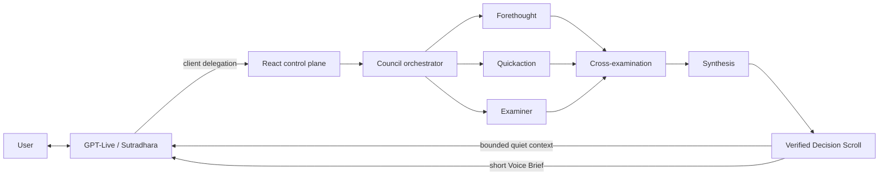
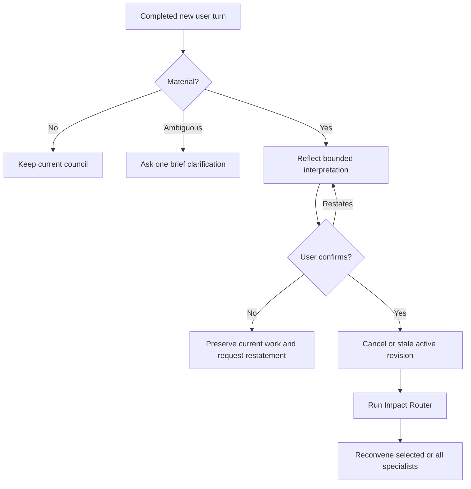
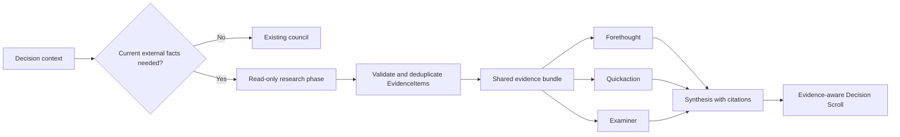

# Sagacity Syndicate: Behind the Scenes

**Original engineering narrative — 27 September 2026**

**Original repository state described:** `main` at `de708d8`

**Consolidation addendum:** 19 October 2026

This document explains what we attempted, how the original OpenAI implementation
evolved, and why apparently simple voice problems required application-level
control. The core narrative below is intentionally historical. The current
repository adds Azure Foundry as a second provider behind shared
`VoiceTransport` and `AgentRuntime` boundaries, uses explicit decision read-back
and approval on both providers, and retains the same Decision Scroll authority.
See [Architecture](../ARCHITECTURE.md) and
[Provider differences](PROVIDER_DIFFERENCES.md) for current behavior.

The companion [interactive system map](sagacity-system-map.html) presents the same system visually.

OpenAI protocol behavior for the original implementation was rechecked on 27 September 2026 against the official [GPT-Live client delegation guide](https://developers.openai.com/api/docs/guides/live-delegation), [GPT-Live WebRTC guide](https://developers.openai.com/api/docs/guides/voice-webrtc?api=live), [Agents API quickstart](https://developers.openai.com/api/docs/guides/agents-api/quickstart), and [run and continue sessions guide](https://developers.openai.com/api/docs/guides/agents-api/sessions).

---

## 1. The product idea

Sagacity Syndicate is a Panchatantra-inspired AI Decision Council. The user talks to a single moderator, Sutradhara, while three bounded specialists work behind that conversational surface:

| Specialist | Role | Character motif |
| --- | --- | --- |
| Forethought | Future risks, scenarios, prevention, and second-order effects | Patient turtle |
| Quickaction | Immediate moves, adaptability, and low-regret experiments | Nimble hare |
| Examiner | Assumptions, contradictions, missing options, and decision tension | Watchful owl |

The intended experience is not “three model responses displayed side by side.” It is:

> A natural conversation with a wise moderator who can convene a structured council, explain its verified decision briefly, and reconvene it safely when reality changes.

The first implementation constraint was equally important: build and prove the council in text before adding GPT-Live. That protected the decision engine from becoming entangled with microphone, transcript, WebRTC, or speech-delivery behavior.

---

## 2. Architectural boundary: conversation is not decision authority

The central design decision is the separation between the conversational layer and the deliberation layer.



### Sutradhara owns

- conversational intake;
- necessary clarification;
- a brief delegation acknowledgement;
- one useful progress update when appropriate;
- conversational explanation of a verified decision;
- follow-up questions grounded in the current Decision Scroll.

### Sutradhara does not own

- specialist analysis;
- the authoritative council state;
- cancellation or revision changes;
- synthesis validation;
- deciding whether a constraint is confirmed;
- publishing a Decision Scroll.

The React application is the control plane. GPT-Live can signal an intent to delegate, but only application code can bind that delegation to a completed user turn, start the backend, accept a current result, reconvene, or suppress stale work.

---

## 3. Repository anatomy

```text
client/
  App.tsx                         product control plane and UI state
  api.ts                         NDJSON council API and assessment calls
  components/                    voice, agents, Scroll, Map, history, diagnostics
  voice/
    live-session.ts              WebRTC and GPT-Live event adapter
    turn-tracker.ts              streaming fragments → bounded turns
    council-lifecycle.ts         active and verified revision ownership
    delegation-coordinator.ts    native delegation/fallback idempotency
    playback-controller.ts       audible interruption and stale-audio suppression
    append-tracker.ts            thinking/commentary/instructions acknowledgements
    serial-task-queue.ts         ordered completed-turn handling
  persisted-decision.ts          current Scroll and bounded history
  pending-constraint.ts          durable correction awaiting confirmation

server/
  index.ts                       local Express API
  live/session.ts                server-side GPT-Live session creation
  agents/runtime.ts              Agents API adapter, streaming and cancellation
  orchestration/council.ts       routing, parallel agents, critique, synthesis
  voice/materiality.ts           bounded materiality assessment
  voice/readiness.ts             clarify-versus-convene assessment
  logging/                       local JSONL decision and lifecycle records

shared/
  schemas.ts                     bounded Zod contracts
  state-machine.ts               legal council transitions
  voice.ts                       deterministic Voice Brief and Live payloads
  voice-policy.ts                local intent and interruption rules
  constraint-confirmation.ts     correction reflection and yes/no classification
  confidence.ts                  recommendation-confidence calibration

prompts/
  forethought.md
  quickaction.md
  examiner.md
  cross-examination.md
  impact-router.md
  synthesis.md
  sutradhara.md
  voice-materiality.md
  voice-readiness.md

tests/                            unit, orchestration, lifecycle and UI contracts
docs/                             architecture, test trails and working evidence
```

Prompts remain separate from orchestration, model names remain configurable through environment variables, and API keys remain server-side.

---

## 4. The text-first council engine

The text-first path established the durable decision machinery before voice was introduced.

### 4.1 Initial round

1. The client submits a `DeliberationRequest` with decision context and captured revisions.
2. The orchestrator enters `independent`.
3. Forethought, Quickaction, and Examiner run in parallel with separate prompts and sessions.
4. Every output is parsed as a bounded `SpecialistOpinion`.
5. The orchestrator enters `cross_examining`.
6. Each selected agent receives its own opinion plus the other opinions and produces a bounded `Critique`.
7. Application code normalizes critique targets so no specialist can critique itself or silently omit a peer.
8. The orchestrator enters `synthesizing`.
9. A separate synthesis session produces a `DecisionScroll`.
10. Zod validation, revision checks, and confidence calibration run before the result becomes authoritative.

Parallelism is deliberate:

```ts
await Promise.all(selected.map(async (agent) => {
  const opinion = await runOpinion(agent, context, changedConstraint);
  opinions[agent] = SpecialistOpinionSchema.parse(opinion);
}));
```

The raw model response is never trusted directly. The schemas define field limits, enumerations, minimum and maximum list sizes, complete-sentence requirements, and cross-field invariants.

### 4.2 Cross-examination

Cross-examination is one bounded round, not an unbounded agent conversation. Each critique may contain:

- up to two agreements;
- one to three challenges;
- revision advice;
- a low, medium, or high severity;
- the two peer targets.

The bounded round gives synthesis real disagreement to resolve without creating an unpredictable debate loop.

### 4.3 Decision Scroll

The authoritative result contains exactly seven fields:

```ts
type DecisionScroll = {
  decision: string;
  rationale: string;
  forethought: string;
  quickaction: string;
  examiner: string;
  triggerToReconvene: string;
  confidence: number;
};
```

This is the single source of truth for the UI, decision history, export, follow-up context, and revised rounds.

---

## 5. The revision model

Two counters solve different problems:

| Revision | Meaning | Changes when |
| --- | --- | --- |
| `conversationRevision` | Version of what the user has said or corrected | A completed, relevant user turn changes conversation context |
| `deliberationRevision` | Version of council computation | A new initial or reconvened council round begins |

Every council round captures both values. A result can render, persist, or reach GPT-Live only if both still match the current round.

```ts
function isCurrent(state, captured) {
  return state.conversationRevision === captured.conversationRevision
    && state.deliberationRevision === captured.deliberationRevision;
}
```

Cancellation is best effort. Revision checking is the safety guarantee.

If a provider responds after cancellation:

```text
late provider output
        ↓
captured revisions do not match
        ↓
council.stale_result.discarded
        ↓
no UI update, no persistence, no GPT-Live append
```

This is why a late response cannot replace or speak over a newer decision.

---

## 6. Why the original voice handoff failed

The early implementation behaved as though every `session.input_transcript.delta` were a new user turn. That is incorrect: a delta is only a fragment of an utterance.

The failure sequence was:

```text
user finishes speaking
→ GPT-Live delegates
→ council starts
→ delayed transcript fragment from the same utterance arrives
→ fragment is treated as a new interruption
→ active council is cancelled
→ Sutradhara has already said the council is working
→ no result returns
```

Adding a timeout would only hide the race. The fix was to model turns explicitly.

```ts
type VoiceTurn = {
  id: string;
  role: "user" | "sutradhara";
  text: string;
  startedAt?: number;
  completedAt?: number;
  complete: boolean;
};
```

`VoiceTurnTracker` merges deltas into one active turn. A turn is completed at the safest available event boundary, with a short transcript-settle fallback after input mute. The delegation is bound by its offset to the causal user turn. That causal turn is never permitted to interrupt its own council round.

Completed turns are then handled through a serial queue so two closely spaced completion/delegation events cannot race through React state independently.

---

## 7. Native delegation plus an application fallback

The preferred path is GPT-Live client delegation:

```text
session.delegation.created
→ bind delegation ID to causal completed turn
→ bind it to current revisions
→ start council
```

During real testing, GPT-Live could conversationally acknowledge the request without always producing the delegation event expected by the application. Therefore the app also has a readiness fallback:

1. A completed user turn is assessed as `clarify` or `convene`.
2. If ready, the app waits a short grace period for native delegation.
3. If no native event arrives, the fallback starts the same council path.
4. The delegation coordinator makes the native and fallback routes idempotent.

This removed the confusing requirement for users to say “convene the council” or click a second button after speaking a complete decision.

---

## 8. Voice interruption is not automatically council invalidation

During deliberation, a completed utterance is first classified locally when obvious and otherwise sent to the bounded materiality assessor.

Examples treated as non-material:

- “Okay.”
- “Go on.”
- “What are they doing?”
- “How long will this take?”

Examples treated as potentially material:

- “My budget is ₹40,000, not ₹1 lakh.”
- “I cannot relocate.”
- “The deadline is next week.”
- “Remove option B.”

The result is constrained to:

```ts
type VoiceInterruptionAssessment = {
  material: boolean;
  changedConstraint?: string;
  reason: string;
  confidence: number;
};
```

Non-material speech does not cancel, revise, or reconvene anything. Ambiguous materiality does not destroy work automatically.

---

## 9. Confirmation-gated material corrections

Testing exposed a more subtle problem: speech transcription could change “now” into “not,” reverse old and new values, or clip part of a correction. Automatically reconvening on that interpretation would make an unverified transcript authoritative.

The current correction flow is therefore:



The durable confirmation record contains:

- the bounded changed constraint;
- a complete confirmation question;
- optional previous and new values;
- interpretation confidence;
- conversation revision;
- timestamp.

It is persisted locally without provider or delegation identifiers. Refreshing the browser while confirmation is pending restores the same state and question; it does not silently reconvene.

A precise typed correction followed by the explicit reconvene action counts as confirmation because the application receives exact user-provided text rather than a speech interpretation.

---

## 10. Reconvening and the Impact Router

When a confirmed constraint changes, the Impact Router compares:

- the previous Decision Scroll;
- the changed constraint;
- the current decision context.

It returns whether the change is material, which agents are affected, which Scroll fields may be preserved, a bounded reason, and confidence.

Routing behavior:

- non-material: preserve the existing result;
- confident narrow impact: continue only affected specialist sessions;
- low routing confidence: rerun all three specialists;
- server restart with only `previousScroll`: rerun all three once to rebuild missing provider/session state.

The previous verified Scroll remains visible while reconvening. Incomplete output never temporarily becomes the decision.

---

## 11. Decision Scroll versus spoken Voice Brief

One of the early product mistakes was assuming the full synthesis should be spoken. A good written artifact and a good spoken response are not the same object.

### Decision Scroll

- authoritative;
- complete;
- persisted and exportable;
- revision checked;
- visible in the UI;
- includes all three perspectives and the reconvening trigger.

### Voice Brief

- deterministic projection from the verified Scroll;
- no more than 120 words;
- approximately 20–40 seconds when spoken;
- recommendation, main reason, key tension, immediate next step, optional trigger;
- never a second source of decision authority.

After synthesis, the app uses GPT-Live channels separately:

| Channel | Payload | Purpose |
| --- | --- | --- |
| `session.thinking.append` | Compact verified council facts | Quiet context for later “Why?” questions |
| `session.instructions.append` | Authoritative lifecycle status | Prevent premature or stale status claims |
| `session.commentary.append` | Bounded Voice Brief facts | Natural short verbal delivery |

Sutradhara paraphrases the brief conversationally rather than reading the Scroll field by field.

---

## 12. Post-decision exploration

After completion, the voice session moves into an exploration mode. Questions such as these use the existing verified Scroll:

- “Why?”
- “What made Forethought cautious?”
- “Why did Quickaction disagree?”
- “What assumption did Examiner challenge?”
- “When should I revisit this?”

They do not rerun the council.

A genuinely changed fact goes through materiality assessment and confirmation before reconvening. This distinction prevents conversational curiosity from creating expensive or destructive backend churn.

---

## 13. Playback interruption and push-to-talk

Backend cancellation and audible interruption are separate controls.

When the user presses push-to-talk while Sutradhara is speaking:

1. Playback is suppressed immediately.
2. The microphone track is enabled.
3. The new user turn is recorded.
4. Assistant audio associated with the interrupted response is treated as stale.
5. Playback is allowed to resume only for current output.

Pointer capture was added so drifting outside the button while holding it no longer ends the turn accidentally. Diagnostics record whether push-to-talk stopped because of `pointer_up`, cancellation, loss of capture, or another boundary.

---

## 14. State machines and visible product modes

The council state machine permits only explicit transitions among:

```text
idle
clarifying
confirming_constraint
ready
routing
independent
cross_examining
synthesizing
completed
interrupted
failed
```

The product presents four dominant modes:

| Product mode | UI priority |
| --- | --- |
| Conversation | Sutradhara, push-to-talk, current transcript |
| Deliberating | Council status, three agent cards, actual phase |
| Completed | Decision headline, confidence, compact perspectives, expandable Scroll |
| Reconvening / confirming | Changed fact, preserved prior Scroll, explicit confirmation or new progress |

The three agent cards are projections of orchestration events, not decorative animations.

---

## 15. Council Map and bounded transparency

The Council Map provides inspectable structure without exposing chain-of-thought. Its `CouncilTrace` contains:

- each specialist’s opening recommendation;
- the bounded challenge directed at each peer;
- the perspective that survived synthesis;
- at most six critique edges.

Application code owns the relationship graph. If a model returns a self-target or omits a peer, targets are normalized before trace construction. This fixed the observed `A specialist cannot critique itself` failure while preserving the bounded schema.

The Map is presentation transparency, not raw reasoning disclosure. Private chain-of-thought, unrestricted model transcripts, and hidden scratch work are neither logged nor rendered.

---

## 16. Persistence and recovery

Browser storage keeps a bounded set of durable product artifacts:

- latest verified Decision Scroll;
- its conversation and deliberation revisions;
- bounded Council Trace;
- recent decision history;
- pending constraint confirmation.

It does not persist:

- microphone audio;
- raw transcript deltas;
- API keys;
- provider session identifiers in pending confirmation;
- chain-of-thought.

After refresh, the current Scroll is restored and supplied to GPT-Live as quiet verified context. After a server restart, `previousScroll` hydrates decision context, but all specialists rerun once because in-memory provider sessions and complete specialist opinions cannot be reconstructed from the Scroll alone.

---

## 17. Logging and observability

Two ignored local JSONL streams support debugging:

```text
logs/deliberations.jsonl
logs/live-events.jsonl
```

Representative lifecycle events include:

```text
live.session.started
live.user_turn.started
live.user_turn.completed
live.readiness.assessed
live.delegation.created / live.delegation.fallback
live.delegation.bound_to_revision
council.started
council.phase
council.completed
live.thinking.sent / acknowledged
live.instructions.sent / acknowledged
live.commentary.sent / acknowledged
live.interruption.materiality
live.constraint_confirmation.requested / accepted / rejected
council.cancel.requested
council.stale_result.discarded
live.playback.suppressed / stale_audio.discarded / resumed
live.session.closed
live.error
```

An append acknowledgement proves that GPT-Live accepted the event. It does not prove the user heard the audio. Audible behavior still requires supervised browser testing.

Logs omit secrets, audio, raw deltas, and chain-of-thought, but may contain bounded decision facts and must be reviewed before sharing.

---

## 18. Confidence semantics

There are two different confidences:

1. **Interpretation confidence** — how confidently the application understood a spoken changed constraint.
2. **Recommendation confidence** — how strongly the verified council result is supported.

They are deliberately separate. Agreement among three agents is not evidence that external facts are correct.

Because the present council works from user-supplied facts rather than a verified evidence tool, application code caps recommendation confidence at `0.85`. The cap can be lifted only when a future evidence phase proves the key supporting facts.

---

## 19. Security and privacy boundaries

- `.env` is ignored by Git.
- `OPENAI_API_KEY` remains on the server.
- Browser code receives the negotiated WebRTC session transport, not the project key.
- Public-document checks reject OpenAI key shapes, GPT-Live session IDs, provider session IDs, delegation IDs, and non-placeholder key assignments.
- The prior GitHub secret-scanning alert was a provider session identifier misclassified as a GoCardless token. Public reports were redacted, a preventive scan was added, and the alert was closed as a false positive.
- No external action tools or private MCP credentials are exposed to the council today.

This remains a local proof of concept, not a multi-tenant production security model.

---

## 20. Test strategy and current evidence

The automated suite covers:

- schema bounds and invariants;
- legal state transitions;
- parallel opinion and critique ordering;
- selective and full reconvening;
- provider cancellation and failure normalization;
- transcript-delta aggregation;
- causal-turn delegation binding;
- non-material interruptions;
- material changes and stale-result suppression;
- Voice Brief word bounds;
- refresh and restart recovery;
- playback suppression;
- pointer-safe push-to-talk;
- decision history and export;
- Council Map integrity;
- correction confirmation and refresh persistence;
- recommendation-confidence calibration.

Latest release evidence at `de708d8`:

```text
21 test files passed
93 tests passed
TypeScript typecheck passed
Production Vite build passed
Public-artifact hygiene check passed
Production-server mock council smoke test passed
```

Real-account testing through 16 September 2026 exercised initial voice delegation, briefing, follow-up exploration, interruptions, reconvening, refresh persistence, server-restart hydration, pointer capture, decision history, and the Council Map. The newest confirmation-gated correction flow is automated-test verified but still needs one focused microphone acceptance run before it should be described as audibly verified.

---

## 21. What changed through testing

| Observed problem | Root cause | Engineering response |
| --- | --- | --- |
| Council said it was working but never returned | Trailing transcript delta cancelled its causal round | Aggregate fragments into turns and bind delegation to the completed causal turn |
| Voice sometimes did not convene automatically | Spoken acknowledgement did not always produce the expected native delegation | Add idempotent readiness fallback |
| Full synthesis sounded unnatural | Written artifact was being treated as spoken output | Create deterministic Voice Brief and split Live channels |
| “Okay” could destroy a running council | Every later utterance was treated as invalidating | Add materiality routing |
| Spoken corrections could reverse meaning | Transcription ambiguity such as “now” versus “not” | Add durable confirmation before reconvening |
| Previous result disappeared during revision | UI treated in-progress output as replacement | Preserve authoritative Scroll until new synthesis completes |
| Self-critique broke Council Map validation | Provider target list was trusted too literally | Normalize peer targets in application code |
| Push-to-talk ended when pointer drifted | Release boundary was tied to pointer location | Capture the pointer and record explicit stop reasons |
| Refresh lost conversational grounding | GPT-Live session memory was not durable application state | Persist Scroll/revisions and rehydrate quiet context |
| Secret scanner flagged a session identifier | Public test trail included provider identifiers | Redact reports and add automated public-artifact scanning |

---

## 22. Current limitations

The proof of concept does not yet provide:

- externally verified facts or citations;
- file, image, offer-letter, or spreadsheet evidence intake;
- multi-user authentication and authorization;
- database-backed durable history;
- production retention and deletion controls;
- usage budgets, rate limits, and operational monitoring;
- production deployment hardening;
- side-effecting council tools.

The provider-session recovery branch is automated-test verified. The repaired live sessions did not encounter another broken stream, so that exact recovery branch has not received a second real provider failure.

---

## 23. Recommended next phase: evidence-aware decisions

The next meaningful improvement is not more dashboard chrome. It is improving the epistemic quality of the decision.

### Proposed bounded evidence contract

```ts
type EvidenceItem = {
  claim: string;
  sourceTitle: string;
  sourceUrl: string;
  retrievedAt: string;
  supports: "decision" | "risk" | "action" | "assumption";
  verificationStatus: "verified" | "user_supplied" | "conflicting";
  confidence: number;
};
```

### Proposed flow



Initial tools should be read-only. Evidence gathering should be optional, time-bounded, source-captured, and clearly separated from council judgment. Side-effecting actions should remain out of scope until explicit approvals, permission boundaries, and audit receipts are designed.

---

## 24. Immediate acceptance test before that phase

Run one real voice session:

1. Reach an initial verified decision.
2. Say: “My budget is now ₹40,000, replacing ₹1 lakh.”
3. Confirm that Sutradhara reflects the direction and does not reconvene yet.
4. Say “No” and verify the active/previous decision remains authoritative.
5. Restate the change.
6. Refresh while the confirmation is visible.
7. Reconnect voice and verify the confirmation returns.
8. Say “Yes.”
9. Confirm that reconvening starts only now.
10. Confirm that the previous Scroll remains visible until the new verified Scroll arrives.

That test closes the only remaining acceptance gap introduced by the latest reliability pass.

---

## 25. Summary

Sagacity Syndicate began as a three-agent decision experiment. It is now a revision-safe local decision system with a conversational voice moderator, explicit application authority, bounded multi-agent deliberation, inspectable but privacy-preserving traces, durable reconvening, and evidence-backed test trails.

The hard work so far was not producing three opinions. It was making the handoff trustworthy:

```text
speech fragment ≠ completed turn
completed turn ≠ delegation
delegation ≠ verified result
conversation ≠ decision authority
cancellation ≠ stale-result safety
agent agreement ≠ factual evidence
```

The next phase should preserve those distinctions while adding shared, cited, externally verified evidence.
