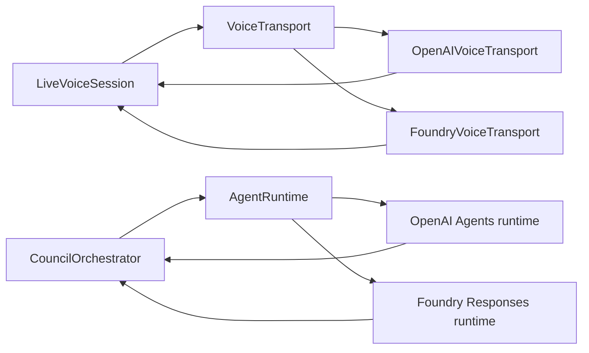

# Provider differences

Sagacity Syndicate runs the same application-owned council over either OpenAI or Azure Foundry. The provider adapters preserve product behavior while translating different wire protocols and model APIs.

## Shared product contract

Both configurations preserve:

- explicit read-back and user approval before the initial voice council;
- the same `VoiceTurn`, readiness, materiality, specialist, critique, Impact Router, Voice Brief, and Decision Scroll schemas;
- independent specialist analysis followed by bounded cross-examination and synthesis;
- `conversationRevision` and `deliberationRevision` stale-result protection;
- prior-Scroll authority during reconvening;
- post-decision questions answered from the verified Scroll without a council rerun;
- local decision history, export, comparison, Council Map, and diagnostics;
- server-side credentials and no stored microphone audio or chain-of-thought.

## Protocol mapping

| Concern | OpenAI configuration | Azure Foundry configuration |
| --- | --- | --- |
| Voice model | GPT-Live model selected by `OPENAI_LIVE_MODEL` | Voice Live model selected by `FOUNDRY_VOICE_MODEL` |
| Browser media | Direct WebRTC session negotiated through `/api/live/session` | WebRTC audio plus server WebSocket control relay at `/api/live/foundry` |
| Transcript source | GPT-Live transcript fragments translated by `OpenAIVoiceTransport` | Foundry final ASR items translated by `FoundryVoiceTransport` |
| Native delegation | May emit client-delegation metadata | No equivalent event is synthesized |
| Approval policy | Application requires exact confirmation; confirmation-turn delegation wins, otherwise the stored decision-turn delegation is used | Same application confirmation; council starts without fabricating native delegation |
| Quiet council context | `session.thinking.append` | Provider-neutral session method translated to a bounded system conversation item |
| Spoken briefing | `session.commentary.append` | Provider-neutral commentary translated into one serialized directed response |
| Specialist runtime | OpenAI Agents API sessions with streaming, continuation, status retrieval, and cancellation | Azure Responses-compatible background calls with polling, previous-response continuation, and cancellation |
| Model configuration | `OPENAI_COUNCIL_MODEL`, `OPENAI_SYNTHESIS_MODEL` | `FOUNDRY_COUNCIL_DEPLOYMENT`, `FOUNDRY_SYNTHESIS_DEPLOYMENT` |
| Credential | `OPENAI_API_KEY` | `FOUNDRY_API_KEY` |

## Why confirmation is identical

The application intentionally does not let provider-specific conversational behavior decide when costly backend work starts. Sutradhara reads back the captured decision and the user explicitly approves it. For OpenAI, native delegation remains useful metadata and is bound to the confirmed request, but it cannot bypass approval. This keeps the visible interaction, safety boundary, and test matrix consistent across providers.

## Runtime boundaries

`LiveVoiceSession` owns shared microphone, completed-turn, playback, and append-correlation behavior. It depends on the `VoiceTransport` interface. `OpenAIVoiceTransport` and `FoundryVoiceTransport` own negotiation, wire messages, and provider event translation.

The council uses an `AgentRuntime` interface. `OpenAIAgentRuntime` and `FoundryAgentRuntime` return the same bounded application schemas to `CouncilOrchestrator`; orchestration does not branch on provider.

## Deliberate non-parity

- Foundry council roles are application-owned personas over the Responses-compatible endpoint, not Foundry Agent Service hosted agents.
- OpenAI native delegation is not emulated on Foundry.
- Provider voices and speech recognition can sound or transcribe differently.
- Transport acknowledgements prove provider acceptance, not that a human heard the audio.
- Provider session identifiers and detailed call mechanics stay out of user-facing artifacts.

These differences do not change the Decision Scroll’s authority or the council state machine.

## Configuration safety

- Unsupported `COUNCIL_PROVIDER` or `VOICE_PROVIDER` values fail startup.
- Model and deployment names are resolved only within the selected provider.
- Foundry voice requires an HTTPS endpoint and key when selected.
- `ALLOWED_ORIGINS` controls permitted browser origins for both local and hosted voice negotiation.
- `REQUIRE_OWNER_AUTH` and `OWNER_PRINCIPAL_ID` support an owner-only hosted Foundry deployment behind platform authentication.

## Validation status

The consolidated implementation has automated coverage for both provider
adapters and passed local owner-device voice runs on both providers. The public
migration and dependency-security changes are merged. The merged public `main`
also passed an owner-authenticated Azure Foundry run covering voice capture,
explicit approval, deliberation, synthesis, bounded Live context/commentary,
and audio playback, together with hosted authentication/origin rejection
checks. The private port is retained unchanged as a rollback reference rather
than as an active implementation.

See [Deploy to Azure](AZURE_DEPLOYMENT.md) for the reproducible hosted topology
and acceptance gate.
